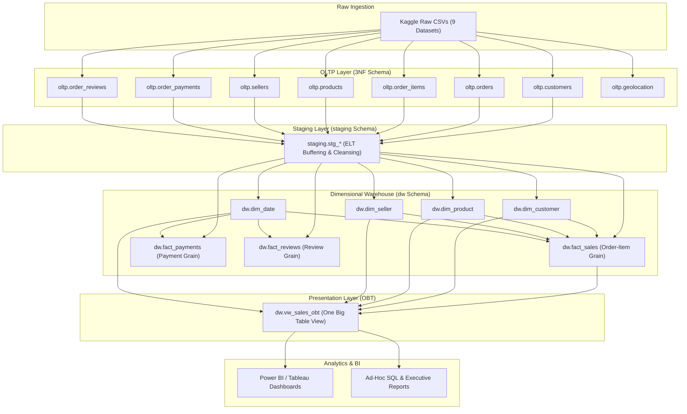
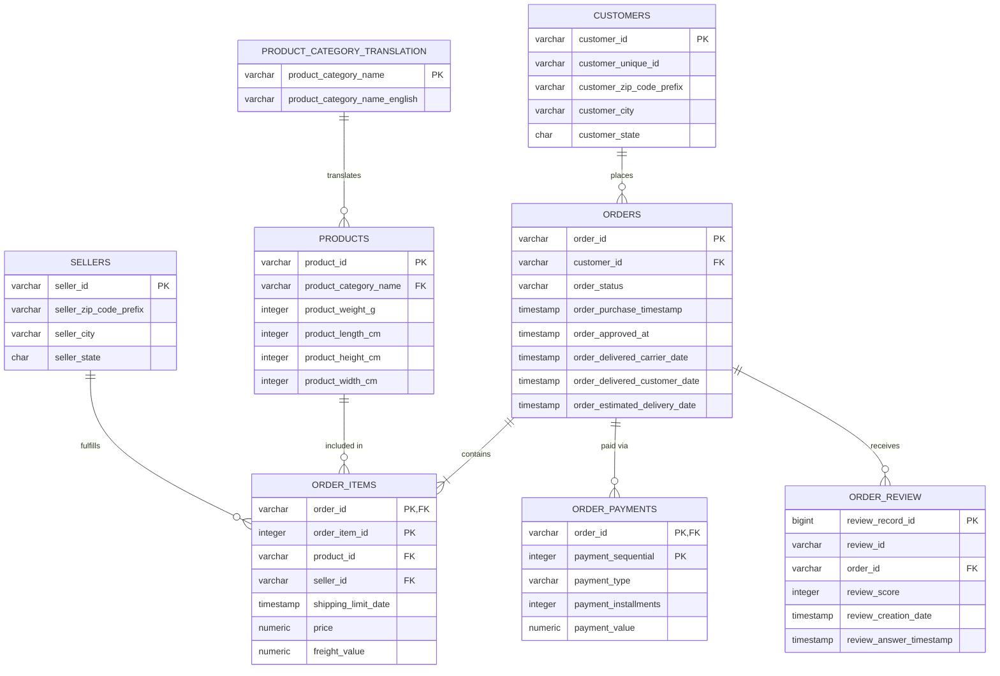
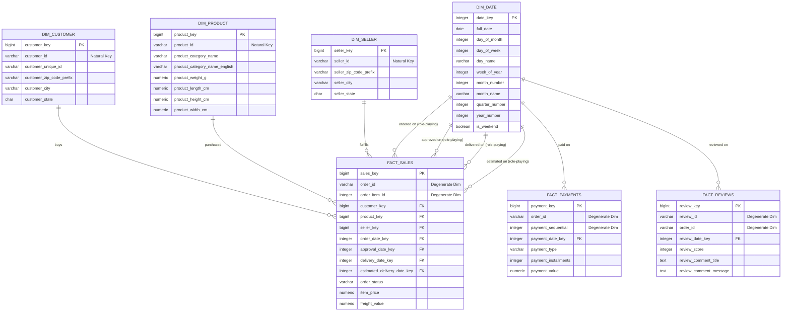

# Architecture & Entity-Relationship Diagrams

This document illustrates the data architecture, entity-relationship diagrams (ERDs), and dimensional modeling structures implemented in the Olist E-Commerce Data Warehouse.

---

## 1. End-to-End Data Pipeline Architecture

---

## 2. OLTP Entity-Relationship Diagram (3NF Normalized)

The transactional layer enforces relational integrity through primary and foreign keys:

---

## 3. Dimensional Data Warehouse Model (Kimball Star Schema)

The analytical data warehouse optimizes queries using synthetic integer surrogate keys and role-playing date dimensions:

---

## 4. Key Modeling Techniques

1. **Surrogate Keys**: `BIGINT GENERATED ALWAYS AS IDENTITY` on all dimension tables isolate the analytical layer from changes in source UUID formats and allow $O(1)$ integer comparisons during joins.
2. **Role-Playing Dimensions**: `dw.dim_date` is joined multiple times to `dw.fact_sales` across different date keys (`order_date_key`, `delivery_date_key`, `estimated_delivery_date_key`), avoiding the creation of duplicate date tables.
3. **Degenerate Dimensions**: `order_id` and `order_item_id` are maintained directly in the fact tables without an extra order dimension table, providing natural groupings for order-level metric calculations.
4. **Zero-Loss Postal Code Integrity**: All zip prefix columns are typed as `VARCHAR(5)` to prevent leading zero truncation (e.g. São Paulo prefixes `01000`–`09999`).
